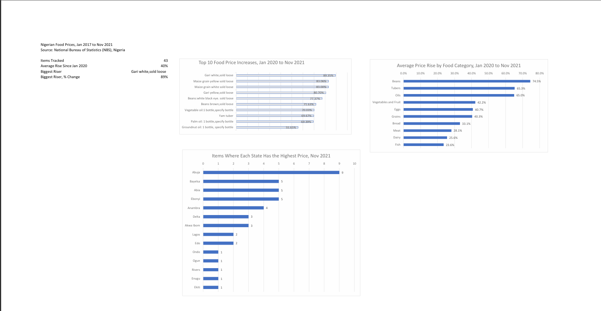

# Nigerian Food Prices, 2017 to 2021 (Excel Project)

## Question
How did Nigerian food prices change, which items rose fastest since Jan 2020, and which states have the highest and lowest prices?

## Data
National Bureau of Statistics (NBS), Nigeria. 43 food items, monthly average prices from Jan 2017 to Nov 2021.

## What I did
- Cleaned the data (rebuilt date headers, removed junk rows, split text columns)
- Added helper columns: category, % change since Jan 2020 and Jan 2017, state and price
- Built PivotTables and an Excel dashboard

## Key findings
- Prices rose 40% on average between Jan 2020 and Nov 2021
- Biggest riser: gari white (+89%), then yellow maize, white maize, yellow gari and white beans
- By category: beans (+74.5%), tubers (+65.3%) and oils (+65.0%) rose most; fish, dairy and meat rose least
- Abuja had the highest price for the most items (9); Bauchi had the lowest for the most (10)

## Files
- `Project1_Excel.xlsx`: full workbook (Findings, Dashboard, Analysis, Clean Data, Raw Data)
- `Nigeria_Food_Prices_Project1.pdf`: findings and dashboard
- `Dashboard.png`: dashboard preview

## Tools
Excel: Tables, formulas, PivotTables, charts

